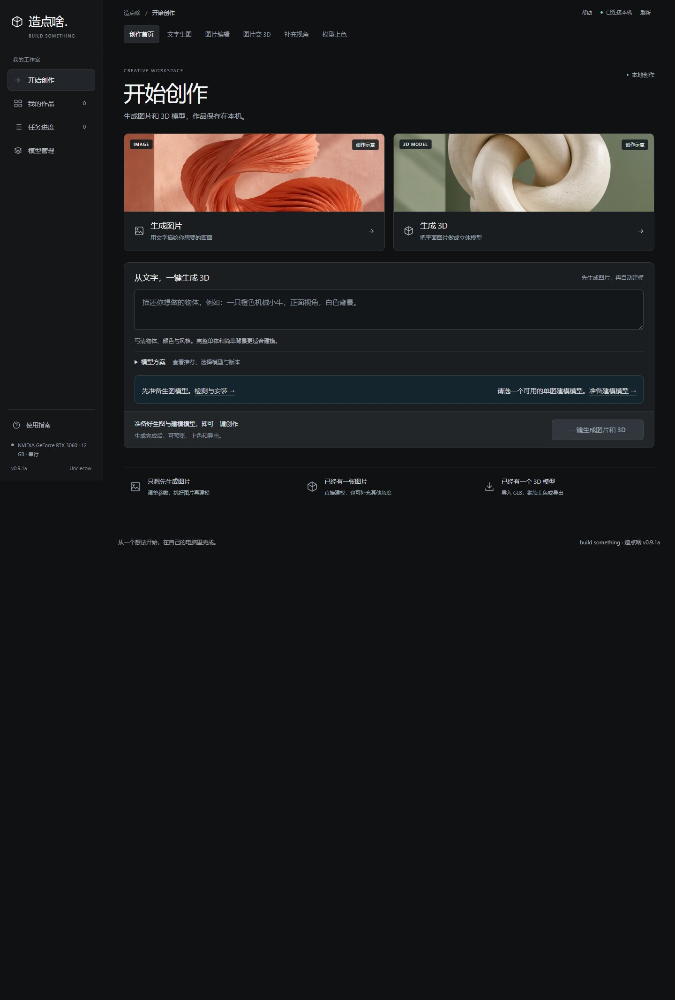

<div align="center">

# BUIDL 2D3D

**先出图，再建模。把脑海里的东西，造出来。**

本地 AI 创作工作台 · Windows x64 · NVIDIA CUDA · `v0.9.1b`

### [下载 Windows 一键启动源码包](https://github.com/wwtlitee/buidl-2d3d/releases/latest)

下载 **`BUIDL-2D3D-0.9.1b-Windows-x64.zip`** → **完整解压** → 双击 **`启动造点啥.vbs`**

[开始使用](#开始使用) · [能做什么](#能做什么) · [模型与硬件](#模型与硬件) · [许可说明](#许可说明)

</div>



<sub>截图来自 v0.9.1a 的独立空数据环境。首页雕塑是装饰示意图，并非本次模型推理成果；图中尚未安装模型。</sub>

你可以从一句话开始，也可以带来一张已经喜欢的图。BUIDL 2D3D 把模型准备、生成队列、作品预览与导出放在一个桌面工作台里，让“先画出来，再做成立体模型”成为一条连续的流程。

应用内沿用原名 **build something · 造点啥**。这是本地运行的创作工具，图片、模型和任务记录保存在你的电脑上。首次准备环境与模型需要联网。

## 从想法到一个 GLB

| ① 准备 | ② 创作 | ③ 带走 |
| --- | --- | --- |
| 检测显卡、内存与空间；阅读许可后安装模型。 | 输入文字生成参考图，或上传自己的图片，再交给建模路线。 | 在“我的作品”里查看结果、旋转预览，导出 GLB 或任务包。 |

已有 GLB 也可以直接导入。作品区区分输入素材与实际生成结果，任务区保留进度、失败原因、取消和重试入口。

## 能做什么

| 工作 | 当前范围 |
| --- | --- |
| **文字生图** | 默认 Qwen Image 2.1，提供量化版本选择；可独立出图，也可接续建模。 |
| **图片变 3D** | 默认 TRELLIS.2；Pixal3D 是另一条带颜色、贴图的路线。轻量几何模型单独分组。 |
| **编辑与补充视角** | 按所装模型提供图片编辑、局部修改、条件控制或多视角参考；能力随模型不同。 |
| **本地作品管理** | 图片与模型预览、GLB 导入/导出、任务包、草稿、串行队列和失败重试。 |
| **模型管理** | 固定来源、文件大小与哈希校验；安装前检查硬件、空间及许可。部分路线需要账号授权或编译工具。 |

本公开版聚焦图片和 3D。视频、自动绑骨与动作不开放新创作或安装；历史记录兼容代码保留。已有带骨骼或动画的 GLB 可预览和导出，但不进入上色流程。

## 开始使用

### 1. 下载、完整解压、双击打开

1. 打开 **[最新发布页](https://github.com/wwtlitee/buidl-2d3d/releases/latest)**，在 **Assets** 中下载 **`BUIDL-2D3D-0.9.1b-Windows-x64.zip`**。
2. 将压缩包**全部解压**到一个可写文件夹。
3. 在解压后的文件夹中双击 **`启动造点啥.vbs`**，等待首次准备完成。

这是完整源码包，仓库与发布包均不附带预编译 EXE。双击脚本会在后台自动从源码生成本机启动器，或复用已经生成的启动器，再打开应用；无需你手动运行命令或编译。请让 `启动造点啥.vbs` 与 `scripts`、`config`、`visual` 等文件夹保持在一起，不要从压缩包内直接运行或只复制启动脚本。

推荐从上方 Releases 下载命名清晰的完整源码包。通过 GitHub **Code → Download ZIP** 或发布页 **Source code** 下载，也可以在完整解压后双击同一个 `启动造点啥.vbs`。已有本机生成的 `造点啥.exe` 仍可留在完整项目目录中双击使用。需要修改或手动构建时，请看后面的[开发者：从源码运行](#开发者从源码运行)。

**首次启动与安装模型需要联网。** 源码包不预装模型权重或完整 Python 环境；启动器会按需准备项目私有的 Python 和 PowerShell。缺少 WebView2 时，由微软官方安装器为当前 Windows 用户补齐。不要求你先手动配置 Python 或 Node.js，也不修改全局 Python / PATH。下载可能需要数分钟或更久，安装进度与失败原因会保留在本机日志中。

### 2. 在“模型管理”准备创作

第一次打开会引导你检测电脑。建议先安装：

- **文字生图 · Qwen Image 2.1**：准备参考图片，默认 Q4_K_M。
- **照片变 3D · TRELLIS.2**：从图片生成带颜色与贴图的模型。

只想把已有图片变成立体模型，可以先装建模路线。每项安装前都能查看下载大小、适用许可和硬件要求；请以界面检查为准，避免一次下载所有模型。

### 3. 回到“开始创作”

描述一个完整、背景简单的单体物品，或上传清晰参考图。生成任务会进入队列；完成后到“我的作品”检查模型，再下载需要的文件。

## 模型与硬件

| 项目 | 需要知道的事 |
| --- | --- |
| 系统 | 当前安装配方面向 Windows 10 / 11 x64。Linux、macOS 和 AMD GPU 路线不在本版支持范围。 |
| 显卡 | 默认生图与带贴图建模路线按 **12 GB NVIDIA 显存**配置；其他候选有独立门槛。能安装不等于所有分辨率都能顺利推理。 |
| 内存与磁盘 | 默认建模配置至少 16 GB 系统内存。模型下载常达数 GB 到十几 GB，还需解压和运行空间；界面会逐项计算。 |
| 网络 | 首次依赖和模型安装需访问 GitHub、Hugging Face 等配置来源；已准备的本地路线在本机计算。 |
| 账号 | 部分模型需要先在官方页面接受条款，再在设置中提供 Hugging Face 只读令牌。令牌按 Windows 用户加密存储，不属于源码。 |

**0.9.1b 延续现有公开范围：** Hunyuan、TripoSG、PartCrafter 等既有路线依赖的第三方打包源码未随仓库分发，其对应候选被标记为不能一键安装。默认 Qwen → TRELLIS.2 / Pixal3D 配方保留。具体原因、保留组件及许可见 [第三方说明](THIRD_PARTY_NOTICES.md)。

模型上色仍是待验收的可选实验路线；本公开包没有提供它依赖的源码包。生成质量会受模型、输入、显存与参数影响，本仓库不承诺任意照片都能获得可直接用于生产的拓扑、材质或几何。

## 开发者：从源码运行

日常使用只需双击根目录 `启动造点啥.vbs`。需要修改代码或手动构建启动器时，在 **Windows PowerShell** 中运行：

```powershell
git clone https://github.com/wwtlitee/buidl-2d3d.git
cd buidl-2d3d
powershell -NoProfile -ExecutionPolicy Bypass -File .\scripts\build-desktop-launcher.ps1
```

也可以通过 **Code → Download ZIP** 获取源码，完整解压后在项目目录运行最后一行命令。源码仓库不存放预编译 EXE；构建脚本使用 Windows 的 .NET Framework 4 C# 编译器，在项目目录生成 `造点啥.exe`。把它留在完整项目目录内，再双击启动。若系统缺少 .NET Framework 4，请通过 Windows 官方组件安装方式补齐。

本机生成的 EXE 不进入源码仓库或发布包。无论通过 Releases、Code ZIP 还是 Git 获取完整源码，都通过同一启动入口和“模型管理”准备依赖与模型，遵循相同的许可和硬件检查。

## 在代码里找到它

```text
VERSION.json                 产品版本与公开发行来源
启动造点啥.vbs               双击入口，后台自动编译或复用本机启动器
visual/                      工作台页面、交互、预览组件与 UI 资产
scripts/
  desktop_launcher.cs        Windows 窗口启动器
  start-desktop-factory.ps1  桌面启动与运行环境准备
  factory_web.py             本机 HTTP 服务
  factory_queue.py           任务、作品与队列
  factory_setup.py           模型安装、许可与下载检查
  templates/                 各类模型适配入口
config/                      固定来源、模型目录与部署配方
tests/                       CPU / 隔离夹具回归检查
docs/images/                 真实空数据工作台截图
PUBLICATION.json             本次公开发行范围与验证说明
```

模型、输入与输出目录在运行时创建，不进入 Git。`scripts/build-*-catalog.py`、旧安装工具与打包脚本是维护入口，部分依赖开发机已准备的环境；日常使用请从桌面入口和“模型管理”开始，不必逐个执行维护脚本。

## 检查与已知边界

公开版基于本地 `0.9.0a` 整理；`0.9.1b` 补齐纯源码双击启动脚本、完整源码发布包与下载指引，延续原有发布范围、许可、干净配置和功能边界。原工作区及旧交付包保持原样。见 [CHANGELOG](CHANGELOG.md)。

用 Python 3.11+ 可运行公开分发和配方的静态检查：

```powershell
python tests/check-public-distribution.py
python tests/check-portable-recipes.py
```

其他队列、图片与 HTTP 夹具测试还需要 Pillow。测试用临时目录和微型本机数据，不需要下载模型；有关运行清单与本次结果见 [PUBLICATION.json](PUBLICATION.json)。原有历史版本检查可能包含开发环境前提，请阅读文件头再运行。

**验证分层：** 源码语法、公开配置、隔离夹具、启动器编译和空数据界面分别检查。本次公开发行没有重新下载所有模型，也没有执行新的 GPU 生成验收；界面截图和自动化通过都不能替代实际推理结果。

## 许可说明

自有代码由 **Unclecow** 按 [MIT](LICENSE) 发布。随源码附带的 `model-viewer`、TripoSR 内部组件，以及安装时下载的运行器、模型和依赖，继续使用各自的许可证；MIT 不覆盖这些第三方内容。详见 [THIRD_PARTY_NOTICES.md](THIRD_PARTY_NOTICES.md)。

如果你也喜欢把想法一点点做成东西，欢迎提交能复现的问题或具体的改进。报告问题时请附版本和必要日志片段，并先移除令牌、个人路径与不希望公开的素材。
